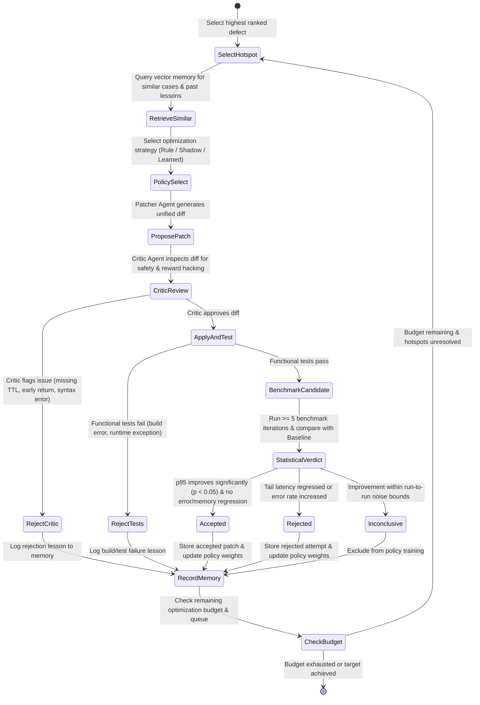
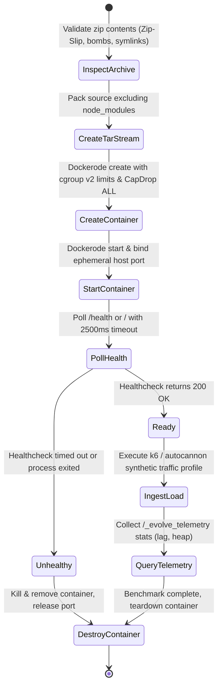

# EVOLVE System Architecture

EVOLVE is an autonomous system optimization and repair platform designed for Node.js / Express applications. It load-tests untrusted uploaded repositories in secured, hardened sandboxes, detects algorithmic and non-functional bottlenecks, proposes AI-driven code patches, verifies them against functional regression suites and statistical load benchmarks, and learns over time using contextual bandit reinforcement learning.

---

## 1. High-Level Architecture & Data Flow

```mermaid
flowchart TD
    User([User / Developer]) -->|Zip / Git URL| WebUI[Client SPA (React + Vite)]
    WebUI -->|REST / SSE| Server[EVOLVE Core Server (Express / BullMQ)]
    
    subgraph Storage & Queues
        MongoDB[(MongoDB - Project State & Experiments)]
        Redis[(Redis - BullMQ Task Queues)]
        Qdrant[(Qdrant / Memory Vector Store)]
    end

    subgraph Sandboxed Execution Layer
        Dockerode[Dockerode Sandbox Runner]
        SandboxContainer[Hardened Container (cgroups v2, CapDrop ALL, Read-Only FS, UID 1001)]
        AutocannonK6[Load Test Harness (k6 / Autocannon)]
        TelemetryShim[Telemetry Hook (Event-Loop Lag, Heap Slope)]
    end

    subgraph Intelligence & Agent Loop
        Analyzer[Python FastAPI / Static Analysis + Anomaly Engine]
        LangGraphLoop[LangGraph Agent Loop (Analyzer, Patcher, Critic, Validator)]
        PolicyEngine[Contextual Bandit Policy (LinUCB / Thompson Sampling)]
    end

    Server <--> MongoDB
    Server <--> Redis
    Server <--> Qdrant
    Server --> Dockerode
    Dockerode --> SandboxContainer
    SandboxContainer --> TelemetryShim
    Server --> AutocannonK6
    AutocannonK6 --> SandboxContainer
    Server <--> Analyzer
    Server <--> LangGraphLoop
    LangGraphLoop <--> PolicyEngine
    PolicyEngine <--> Analyzer
```

---

## 2. Component Responsibilities

### 2.1 Core Orchestrator Server (`server/`)
- **Technology**: Node.js, Express, Mongoose, BullMQ, ioredis.
- **Responsibilities**:
  - Exposes RESTful API endpoints and Server-Sent Events (SSE) streaming.
  - Multi-tenant authentication and project ownership enforcement with async salted PBKDF2 and HMAC-SHA256 JWTs.
  - Ingestion pipeline with Zip-Slip path traversal protection, symlink rejection, decompression bomb size/file count guards, and binary execution prevention.
  - Manages asynchronous background jobs: `sandbox` (baseline & candidate execution), `analysis` (static scan & flamegraph generation), `optimize` (multi-step agent loop).
  - Statistical hypothesis testing (`metricsCompare.js`) via Mann-Whitney U tests and bootstrap confidence intervals.

### 2.2 Hardened Sandbox Runtime (`sandbox/` & `server/src/services/sandboxRunner.js`)
- **Technology**: Dockerode / Linux cgroups v2 / Local isolation fallback.
- **Security Guarantees**:
  - Strict resource constraints: 1 CPU core, 512MB RAM, 100 PIDs limit (anti-fork bomb).
  - Unprivileged user execution: UID 1001 / GID 1001 (`evolve`).
  - Read-only root filesystem with ephemeral, in-memory `/tmp` mount (`tmpfs`).
  - Dropped Linux capabilities (`CapDrop: ['ALL']`) and `no-new-privileges` flag.
  - Complete network isolation during benchmarking; localhost ephemeral unprivileged port forwarding for traffic ingestion.
  - Telemetry shim (`sandbox/telemetry.js`) measuring event-loop lag percentiles (p50, p95, p99) via `perf_hooks.monitorEventLoopDelay` and heap allocation trajectories.

### 2.3 Statistical Profiling & Anomaly Engine (`analyzer/`)
- **Technology**: Python 3.10+, FastAPI, NumPy, SciPy, Scikit-learn.
- **Responsibilities**:
  - Ingests telemetry time series and computes statistical anomaly scores.
  - Hotspot identification and ranking across 5 defect categories: `performance`, `reliability`, `security`, `architecture`, `other`.
  - Offline evaluation (IPS / Doubly Robust) of contextual policy performance.

### 2.4 Contextual Bandit Policy Engine (`analyzer/policy/` & `server/src/agents/policy.js`)
- **Technology**: Contextual Thompson Sampling, LinUCB with rank-1 Sherman-Morrison updates, action masking.
- **Arms**: `cache`, `index`, `batch`, `async`, `pool`, `pagination`, `compression`.
- **Modes**:
  - `rule`: Hard-coded heuristic fallback mapping defects to strategies.
  - `shadow`: Rule-based execution with asynchronous logging and agreement tracking against learned arms.
  - `learned`: Thompson sampling exploration with LinUCB point estimates under action masking constraints.

### 2.5 Experiment Memory & Vector Store (`server/src/services/vectorStore.js`)
- **Technology**: Qdrant / Deterministic cosine text projection vector store.
- **Responsibilities**:
  - Embeds AST context, function names, and normalized feature vectors into 128-dimensional dense embeddings.
  - Nearest neighbor retrieval for similar past defect resolutions.
  - Surfaces negative lessons from rejected candidate patches to prevent repeated cycles of failure.

### 2.6 App Shell & Navigation Dashboard (`client/`)
- **Technology**: React 18, Vite, React Router, TailwindCSS / Custom responsive stylesheet.
- **Views**:
  1. **Overview**: Pipeline stepper, KPI cards, Before-vs-After p95 distribution bars with bootstrap CIs, experiment timeline drawer.
  2. **Baseline**: Route list, p50/p95/p99 latency cards, RPS throughput, error rates, capacity classification.
  3. **Defects**: Ranked defect list with severity badges, source code line snippets, and anomaly scores.
  4. **Optimize**: Real-time SSE progress tracker, live diff viewer with syntax highlighting, critic rejection feedback.
  5. **Memory**: Strategy $\times$ Category win rate matrix, lesson viewer, and nearest neighbor search playground.
  6. **Policy**: Mode toggle (`rule`, `shadow`, `learned`), empirical reward heatmap, parameter weights chart, simulation curves.
  7. **Reports**: Multi-format final report viewer and 1-click artifact downloads (HTML, PDF, Markdown, JSON).
  8. **Settings**: Sandbox security guarantees, GDPR data export, and cascading project deletion.

---

## 3. State Machine Diagrams

### 3.1 Autonomous Agent Optimization Loop State Machine



### 3.2 Sandbox Container Lifecycle



---

## 4. Communication Protocols

| Interface | Protocol | Transport | Serialization | Purpose |
| :--- | :--- | :--- | :--- | :--- |
| Client $\to$ Server | REST | HTTP / HTTPS | JSON | CRUD operations, authentication, report retrieval |
| Server $\to$ Client | SSE | HTTP Streaming | `text/event-stream` | Real-time optimization progress updates |
| Server $\to$ Redis | Redis RESP | TCP Loopback / Net | Binary / String | BullMQ job queuing, lock acquisition |
| Server $\to$ Sandbox | Docker API | Unix Domain Socket / Named Pipe | Tar / JSON | Container lifecycle management |
| Harness $\to$ Sandbox | HTTP | TCP Loopback Port | JSON / Raw HTTP | Synthetic load traffic injection |
| Server $\to$ Analyzer | REST | HTTP | JSON | Feature extraction, policy queries, anomaly scoring |
